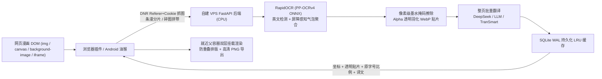

# ComicBubble AI — 自托管无痕擦字漫画气泡英译中插件

[](#)
[-0ea5e9.svg)](#)
[](#)
[](LICENSE)

一款**零构建、无平台积分限制、支持桌面与 Android 手机**的开源漫画气泡英译中工具，包含：
- **Chrome / Edge (Manifest V3) 浏览器插件**（支持桌面端 & Android 扩展浏览器）
- **Android 通用油猴脚本**（`.user.js`，支持 Firefox / 狐猴 / Via / X 浏览器）
- **纯 CPU 轻量自托管 Python 后端**（2 核 2GB 内存 VPS 即可流畅运行，无需 GPU / PyTorch）

---

## 核心特性

- **像素级透明无痕擦字（零方框感、零残影）**
  - 后端精准提取英文字母墨水掩码并自动保护气泡黑色轮廓，生成 **Alpha 透明羽化 WebP 贴片**：仅抹除原英文字母笔画，外围 100% 透明直透原画，绝不压坏气泡黑边。
- **原漫画字号自动识别与气泡安全排版**
  - 按每个气泡的原始英文行高估算 `origFontRatio`（大喊大字、低语小字、常规对白全页协调），自动向气泡内部空白安全扩展排版空间，支持碰撞防重叠推移与中文标点智能断行。
- **深度条漫（Webtoon / 韩漫）专项优化**
  - **亚像素浮点坐标**：万像素超长图贴片对齐误差 `< 0.05px`。
  - **视口优先插队 + 整话持续后台预翻**：当前屏幕优先出字，阅读时后台自动按阅读顺序向下翻完后续分片与图片；支持 **一键全话强制翻完（自动唤醒 `data-src` / `loading="lazy"` 懒加载图 + 底部实时进度条）**。
  - **紧贴碎图自动拼带**：相邻 2~4 张同宽短切片自动合并送翻，根治跨图缝腰斩气泡并支持跨缝无缝渲染。
- **全形态漫画载体 & 防盗链抓图**
  - 支持 ``、`<canvas>`、CSS `background-image` `<div>` 与 `iframe`（`all_frames: true`）。
  - 内置 `declarativeNetRequest` 会话级动态注入原站 `Referer` + `Cookie` 绕过防盗链 CDN，并支持 `captureVisibleTab` 视口截屏兜底。
- **官方本土化级多引擎翻译（0 成本或汉化组级 LLM）**
  - **作品设定激活 + 作品级持久化术语表**：自动携带漫画网页标题与 URL 识别作品 ID，按作品在 SQLite 中自动提取并锁死高频专词（人名、家族、地名、魔物等，支持 `/api/v1/glossary` 查询），跨屏与跨话 100% 统一不漂移。
  - **汉化组本土化重写**：针对“韩→英→中”二手英翻腔深度重写，自动纠错 OCR 粘连/错字，按对白/旁白/喊叫气泡自动切换语气，并维护按作品隔离的滚动前文记忆。
  - **VPS 后端模式（推荐）**：支持 OpenAI 兼容文本大模型（DeepSeek / Qwen / GPT-4o-mini 等）、Gemini 文本 API，未填 Key 时自动走国内直连免费的 **腾讯 TranSmart**（`~300ms` 批量极速）并回退 MyMemory / Google。
  - **纯插件直连模式（无需 VPS）**：也可在插件中直接切换为直连 Google Gemini 或 OpenAI 兼容视觉大模型。
- **双端交互 & 高清导出**
  - 桌面端：鼠标悬停看英文原文、双击气泡在线微调译文、`Alt + T` 切换原文/译文、`Alt + A` 一键全话翻完、单张/整页合成导出高清 PNG。
  - Android 端：窄屏尺寸阈值自适应、可拖动半透明悬浮球「译」、轻点气泡弹出底部原文对照与编辑抽屉。

---

## 系统架构



---

## 目录结构

```text
.
├── manifest.json                   # Chrome / Edge MV3 扩展清单
├── icons/                          # 扩展图标 (16 / 48 / 128)
├── src/
│   ├── shared/config.js            # 默认配置、存储读写、黑白名单匹配
│   ├── background/service-worker.js# DNR 防盗链抓图、截屏兜底、VPS/VLM 调用、本地缓存
│   ├── content/
│   │   ├── image-utils.js          # 全载体抓图、条漫虚拟分片、碎图拼带、高清 PNG 导出
│   │   ├── content.js              # 两级优先级调度、一键全话 data-src 唤醒、双层渲染、移动端适配
│   │   └── content.css             # 隔离样式、悬浮工具条、进度条、移动端悬浮球与抽屉
│   ├── popup/                      # 弹窗控制台与快速引擎配置
│   └── options/                    # 高级设置页（自定义 Prompt、黑白名单、字体、缓存管理）
├── mobile/
│   └── comicbubble-mobile.user.js  # Android 通用单文件油猴脚本
└── server/                         # 纯 CPU 轻量原生 Python VPS 后端
    ├── app.py                      # FastAPI 接口 (/health, /api/v1/translate, /api/v1/translate-json)
    ├── pipeline.py                 # RapidOCR + 气泡黑边屏障聚合 + Alpha 羽化无痕擦字 + 原字号估算
    ├── translator.py               # DeepSeek / OpenAI / Gemini / 腾讯 TranSmart / MyMemory / Google
    ├── cache.py                    # SQLite WAL 持久化 LRU 缓存
    ├── config.py                   # 环境变量配置
    ├── requirements.txt            # 轻量 CPU 依赖（零 PyTorch）
    ├── .env.example                # 配置文件模板
    ├── comicbubble.service         # systemd 常驻服务模板
    └── install.sh                  # Linux VPS 一键安装脚本
```

---

## 快速开始

### 一、部署轻量 CPU VPS 后端（推荐，2 核 2GB 即可运行）

1. 将 `server/` 目录上传到你的 Linux VPS（Ubuntu / Debian 等）：
   ```bash
   scp -r server root@你的VPS_IP:/opt/comicbubble-server
   ```
2. 登录 VPS 运行一键安装脚本（自动建 `.venv`、装依赖、生成随机 `API_TOKEN` 并启动 `systemd` 服务）：
   ```bash
   cd /opt/comicbubble-server
   chmod +x install.sh
   sudo ./install.sh
   ```
3. 记下终端输出的 **`API_TOKEN`**，并确保云服务器安全组/防火墙已放行 `8765` 端口（生产环境建议套 Nginx / Caddy 反代 HTTPS）。
4. **（可选，强烈推荐）配置 DeepSeek / 任意 OpenAI 兼容文本大模型**：
   - 不填任何 API Key 时，默认走免费 **腾讯 TranSmart**（`~300ms`，极速零成本）。
   - 编辑 `/opt/comicbubble-server/.env`，填入 `OPENAI_API_KEY`（如 DeepSeek `deepseek-chat`，千页漫画成本约几毛钱，译文接近汉化组水准）后重启即可生效：
     ```bash
     nano /opt/comicbubble-server/.env
     sudo systemctl restart comicbubble
     ```

<details>
<summary>常用运维与 Nginx HTTPS 反向代理参考</summary>

```bash
# 查看实时服务日志
journalctl -u comicbubble -f

# 修改 .env 后重启服务
sudo systemctl restart comicbubble
```

```nginx
server {
    listen 443 ssl http2;
    server_name comic.example.com;

    client_max_body_size 25M;

    location / {
        proxy_pass http://127.0.0.1:8765;
        proxy_set_header Host $host;
        proxy_set_header X-Real-IP $remote_addr;
        proxy_read_timeout 60s;
    }
}
```

</details>

---

### 二、桌面浏览器安装（Chrome / Edge）

1. 打开扩展管理页：`edge://extensions/` 或 `chrome://extensions/`，开启右上角 **开发人员模式**。
2. 点击 **加载解压缩的扩展**，选择本项目根目录（包含 `manifest.json` 的目录）。
3. 点击浏览器右上角 **ComicBubble AI** 图标 → **「引擎配置」**：
   - 选择 **自建 VPS 无痕擦字后端**，填入 `http://你的VPS_IP:8765`（或 HTTPS 域名）与 `API_TOKEN`。
   - 点击 **「测试连通性」**，通过后会自动保存配置并立即开始翻译当前页。
   - *（如果没有 VPS，也可切换为「直连 Google Gemini」或「直连 OpenAI 兼容视觉接口」直接使用。）*

---

### 三、Android 手机端安装

支持两种方式，均与电脑端共用同一台 VPS 与缓存：

1. **导入浏览器扩展包（狐猴 Lemur / Kiwi / Mises 浏览器）**：
   - 将仓库中的 `manifest.json`、`icons/`、`src/` 打包为 `.zip`（不含 `server/`）传到手机，在浏览器扩展页开启开发者模式并选择「从 `.zip` 加载」。
2. **安装单文件油猴脚本（Firefox Android / 狐猴 / Via / X 浏览器 + Tampermonkey）**：
   - 导入 [mobile/comicbubble-mobile.user.js](mobile/comicbubble-mobile.user.js)，打开漫画页后点击右下角悬浮球 **「译」→「VPS 设置」**，填入你的 VPS 地址与 Token 即可。

---

## 常用快捷键与交互

| 操作 | 说明 |
| :--- | :--- |
| `Alt + T`（桌面） / 悬浮球「隐藏译文」（手机） | 一键切换隐藏 / 显示全部中文译文，快速对照原图 |
| `Alt + A`（桌面） / 悬浮球「一键全话翻完」（手机） | 唤醒整话 `data-src` 懒加载图并持续翻译至 100%（带进度条与停止按钮） |
| 鼠标悬停气泡（桌面） / 轻点气泡（手机） | 查看对应英文原文对照 |
| 双击气泡（桌面） / 底部抽屉编辑（手机） | 在线修改中文译文并同步写入缓存（导出 PNG 时同步生效） |
| 右键任意图片 / Canvas | 单张强制触发翻译（忽略尺寸限制） |
| 图片右上角悬浮条「导出」 | 将透明无痕擦字贴片与译文合成回原分辨率图片并下载 PNG |

---

## 翻译引擎速度与质量参考（2 核 2GB 国内 CPU VPS 实测）

| 翻译引擎 | 单片翻译耗时 | 特点 |
| :--- | :--- | :--- |
| **腾讯 TranSmart（免费默认）** | ~0.3 秒 | 极速零成本、国内直连、人名准确，偶有轻微机翻腔 |
| **DeepSeek (`deepseek-chat`)** | ~1.1 秒 | 理解整页语境、口语与专词准确（接近汉化组），千页仅几毛钱 |
| **MyMemory / Google Free** | ~1.5 ~ 3.5 秒 | 自动兜底备用 |

---

## 安全提示

- 请务必在 VPS 的 `server/.env` 中设置强随机 `API_TOKEN`（`install.sh` 会自动生成），勿将 `.env` 或包含个人密钥的打包文件提交至公开仓库。
- 仅在合法授权阅读场景下使用本工具，尊重漫画原作者及版权方权益。

## License

[MIT](LICENSE)
